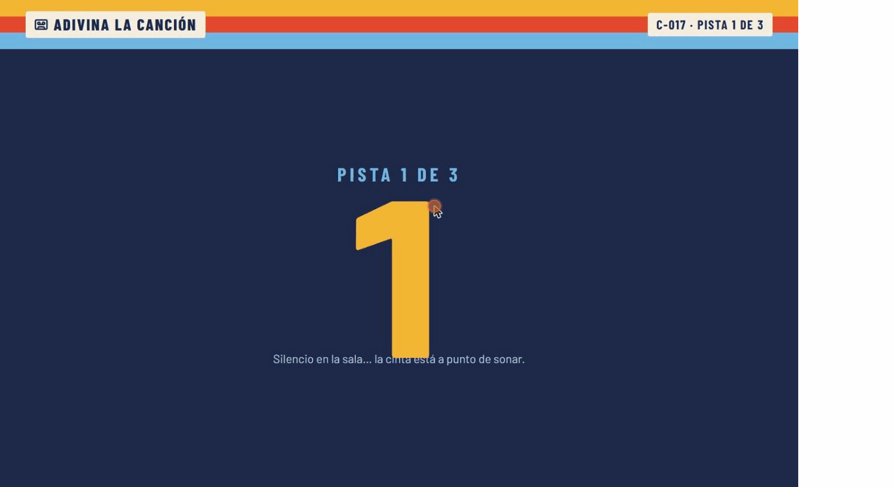

# Adivina la canción 🎵

[](https://github.com/douglaspr20/guessing-song-app/actions/workflows/ci.yml)


A "guess the song" party game for family get-togethers. A clip of at least 60 seconds plays from the host's Spotify; whoever recognizes it shouts the title (and the artist), the host types it in, and the faster you answer the more points you get.

The interface is designed around a **home-recorded cassette**: every game is a numbered tape (`C-014`) on a shelf, the round timer is the tape running from one reel to the other, and the scoreboard is hand-written on the J-card.



> The UI is in Spanish: the game was built for Spanish-speaking families.

## Two ways to play

| | Spotify mode | Open mode (no account) |
|---|---|---|
| Music | Full tracks from the host's Spotify (Web Playback SDK) | 30-second previews from the public iTunes Search API |
| Needs | Spotify Premium, Chrome or Edge, a dashboard-authorized account | Nothing: any browser, including mobile and Safari |
| Clip | 60–180 s from a random point | The 30 s preview |
| Title points | 3 / 2 / 1 before 20 s, 40 s or later | 3 / 2 / 1 before 10 s, 20 s or later |
| Hints | words 20 s · artist 40 s · letters 60 s | words 10 s · artist 20 s · letters 25 s |
| Sources | Search filters or your own playlists | Search filters (genre, language/store, years, keyword) |

## Features

- **Spotify playback in the browser** through the Web Playback SDK: clips of 60–180 s from a random point of the song (skipping long intros).
- **Open mode without any account:** 30-second iTunes previews played with a plain `<audio>` element, so anyone can try the game.
- **Song sources:** general search (genres, language/market, year range, keyword) or your own playlists, including *Liked Songs*.
- **Speed-based scoring:** title worth 3 / 2 / 1 points depending on how fast it is guessed (see the table above); **+1 for the artist**, independent from the title, only before the artist hint appears.
- **Progressive hints:** number of words in the title → artist → first letters (`D_ M_____ L_____`).
- **Forgiving answer matching:** ignores accents, case, `- Remastered 2011`, `(feat. …)` and small typos (Levenshtein similarity); a distinctive word of the artist's name is enough (`soda` → *Soda Stereo*).
- **Host override:** accept an answer the matcher rejected (great for people who describe an English song they can't spell); points are computed from the moment the answer was given.
- **Pause that really pauses:** the server-side clock for points and hints freezes too. Reloading mid-round leaves the round paused and **Seguir** resumes the clip where it stopped.
- **Instant next round:** the next song is picked in the background while the current one plays.
- **Shelf of past games** with a podium (ties share a place), a 3-second suspense countdown between rounds, and a final podium with tape-strip confetti.

## Tech stack

| Layer | Choice |
|---|---|
| Framework | Next.js 16 (App Router, Route Handlers, `cacheComponents`) · React 19 · TypeScript |
| Data | Prisma 6 + SQLite |
| Music | Spotify Web API + Web Playback SDK (OAuth Authorization Code flow, tokens refreshed server-side) |
| Validation | Zod |
| UI | CSS Modules with design tokens, `next/font` (Barlow, Barlow Condensed, Kalam), lucide icons |
| Quality | Vitest, ESLint, GitHub Actions |

## Technical highlights

- **The server owns the clock.** Each round stores when it first started playing and how long it was paused; points, hint unlocks and the artist window are all derived from that, so they stay consistent across reloads and are ready for multi-device play.
- **Race-safe scoring.** "First correct answer wins" is enforced with conditional updates inside a transaction (`updateMany … where winnerPlayerId IS NULL`), not with client-side checks.
- **Background preloading.** After a round starts, `after()` picks and stores the next track (invalidated if filters change), cutting the time to start a round from ~2 s to ~15 ms.
- **One player interface, two backends.** A shared fragment timer drives either the Spotify SDK or an `<audio>` element; the game screen doesn't know which. Scoring and hint timings come from per-mode rules (`SPOTIFY_RULES` / `OPEN_RULES`).
- **One Spotify player for the whole app.** Next 16 keeps pages alive between navigations (React `<Activity>`), so the SDK player is a module-level singleton; if Spotify answers *Device not found*, the server looks the player up by name, transfers playback and retries.
- **Clean domain layer.** Route handlers only validate and delegate to `src/lib/game/service.ts`; game rules (`scoring.ts`, `matcher.ts`, `track-picker.ts`) are pure functions with unit tests and an injectable track source.
- **Living with Spotify's API limits.** Endpoints removed for new apps (recommendations, genre seeds) are replaced by a curated genre list and randomized search offsets; playlists the API can't read are detected and skipped.

## Spotify limitations (please read)

- Playing full tracks requires **Spotify Premium** and a browser with DRM support (**Chrome or Edge**).
- Apps in Spotify's **development mode** only work for the owner and a few users added by hand in the dashboard. Visitors can't play with their own accounts unless they are on that list.
- In development mode Spotify only lets the app read **playlists you own or collaborate on**; other people's playlists show up disabled.
- While a song plays, Spotify apps logged into the same account (e.g. your phone) display the track name, so keep them out of sight.

## Getting started

Requirements: Node 20+, a Spotify Premium account.

1. Create an app at <https://developer.spotify.com/dashboard>:
   - Redirect URI: `http://127.0.0.1:3000/api/auth/callback` (Spotify doesn't accept `localhost`).
   - Enable **Web API** and **Web Playback SDK**.
   - Add your account under *User Management*.
2. Copy `.env.example` to `.env.local` and fill in `SPOTIFY_CLIENT_ID` and `SPOTIFY_CLIENT_SECRET`.
3. Install and create the database:
   ```bash
   npm install
   npm run db:migrate
   ```
4. Run it and open **http://127.0.0.1:3000** (opening `localhost` redirects there during login):
   ```bash
   npm run dev
   ```

> On Windows, if `prisma migrate` fails with `schema-engine-windows.exe ENOENT`, set `PRISMA_SCHEMA_ENGINE_BINARY` to the absolute path of `node_modules\@prisma\engines\schema-engine-windows.exe`.

## Scripts

| Command | What it does |
|---|---|
| `npm run dev` | Development server |
| `npm test` | Unit tests (Vitest) |
| `npm run typecheck` | Route types + `tsc --noEmit` |
| `npm run lint` | ESLint |
| `npm run build` | Production build |
| `npm run db:migrate` | Apply Prisma migrations |

## API overview

| Method | Route | Purpose |
|---|---|---|
| GET | `/api/auth/login` · `/api/auth/callback` | Spotify OAuth |
| GET | `/api/auth/status` | Connected account and Premium check |
| GET | `/api/spotify/playlists` · `/api/spotify/genres` | Filter options |
| POST | `/api/spotify/sample` | Preview which song a set of filters would pick |
| GET / POST | `/api/games` | Recent games with podium / create a game |
| GET · PATCH · DELETE | `/api/games/:id` | Game state / change filters / delete |
| POST | `/api/games/:id/players` | Add a player `{ name }` |
| POST | `/api/games/:id/rounds` | Start the next round |
| POST | `/api/games/:id/rounds/:rid/{play,pause,resume,reveal}` | Playback and round control (`play` takes `{ deviceId, offsetMs? }` to resume mid-clip) |
| GET / POST | `/api/games/:id/rounds/:rid/guesses` | List / submit `{ playerId, title?, artist? }` |
| POST | `/api/games/:id/rounds/:rid/guesses/:gid/accept` | Host override `{ title?, artist? }` |

## Project structure

```
src/lib/spotify/   OAuth + token refresh, API client with retries, sources, playback
src/lib/game/      service (use cases), scoring, matcher, track picker, filters (zod), event bus
src/lib/client/    browser API client and the shared Spotify player
src/app/           pages (shelf, new game, game) and API route handlers
src/components/    cassette timer, scoreboard, podium, stepper, confetti
prisma/            schema and migrations
```

Design decisions are documented in [`DESIGN.md`](DESIGN.md) and product context in [`PRODUCT.md`](PRODUCT.md).

## Roadmap

- Join from your phone with the game code (real-time answers via SSE).
- A public deployment (Postgres + Vercel) so the open mode can be played online.
- Teams, cross-game stats and no repeated songs between games.

## Known issues

- `npm audit` reports advisories in `braces`, pulled in by `eslint-config-next`. It only affects linting (no fixed version exists yet); the suggested `--force` fix would downgrade the Next ESLint config.

## License

[MIT](LICENSE) © 2026 Douglas Pérez
