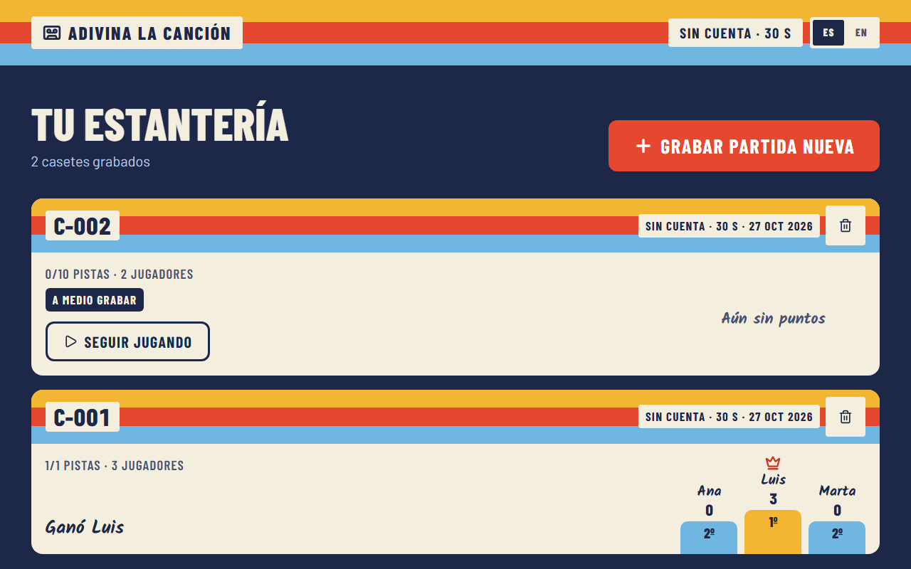
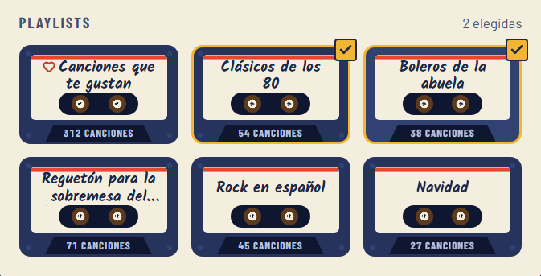
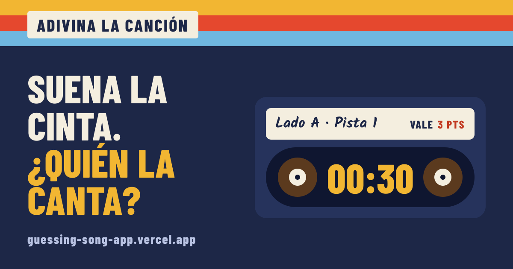

# Adivina la canción 🎵

[](https://github.com/douglaspr20/guessing-song-app/actions/workflows/ci.yml)


**▶ Play it: [guessing-song-app.vercel.app](https://guessing-song-app.vercel.app)** (no account needed) · Made by [Douglas Pérez](https://www.linkedin.com/in/douglas-perez-software-developer/)

A "guess the song" party game for family get-togethers. A clip of at least 60 seconds plays from the host's Spotify; whoever recognizes it shouts the title (and the artist), the host types it in, and the faster you answer the more points you get.

The interface is designed around a **home-recorded cassette**: every game is a numbered tape (`C-014`) on a shelf, the round timer is the tape running from one reel to the other, and the scoreboard is hand-written on the J-card.


> The UI is in **Spanish and English**: it follows the browser's language, with an ES · EN switch in the top band (see [Languages](#languages)). The screenshots are in Spanish, the language the game was built for.

| Your shelf of recorded games | Your playlists as cassettes |
| --- | --- |
|  |  |

Sharing a link shows this card (generated per language with `ImageResponse`, see `src/app/og/[locale]/route.tsx`):



## Two ways to play

|              | Spotify mode                                                    | Open mode (no account)                                 |
| ------------ | --------------------------------------------------------------- | ------------------------------------------------------ |
| Music        | Full tracks from the host's Spotify (Web Playback SDK)          | 30-second previews from the public iTunes Search API   |
| Needs        | Spotify Premium, Chrome or Edge, a dashboard-authorized account | Nothing: any browser, including mobile and Safari      |
| Clip         | 60–180 s from a random point                                    | The 30 s preview                                       |
| Title points | 3 / 2 / 1 before 20 s, 40 s or later                            | 3 / 2 / 1 before 10 s, 20 s or later                   |
| Hints        | words 20 s · artist 40 s · letters 60 s                         | words 10 s · artist 20 s · letters 25 s                |
| Sources      | Search filters or your own playlists                            | Search filters (genre, language/store, years, keyword) |

## Who can play

| Role | How they get in | What they can do |
| --- | --- | --- |
| Host | A hidden page, with a password **and** a 6-digit TOTP code (both secrets live in environment variables). Never through Google | Everything, plus the control panel: invitations, members, Spotify permission, guest moderation |
| Invited member | Username and password with a single-use invitation code, or a free account that redeemed one (or got it from the host) | Open mode, and Spotify mode with **their own** Spotify account (if the host added it to the Spotify dashboard) |
| Free account | "Continuar con Google": open to anyone, no invitation | Open mode with its own history across devices, same limits as guests |
| Guest | "Jugar sin cuenta" (an anonymous cookie, no data asked) | Open mode with limits. Only sees the games created in that browser |

Spotify only grants extended API access to registered businesses with 250k+ monthly users, so a hobby app stays in _development mode_: at most 5 Spotify accounts, added by hand. Each member links their own account instead of borrowing the host's (a Premium account only plays on one device at a time). Open mode is the public way in.

## Features

- **Spotify playback in the browser** through the Web Playback SDK: clips of 60–180 s from a random point of the song (skipping long intros).
- **Open mode without any account:** 30-second iTunes previews played with a plain `<audio>` element, so anyone can try the game. iTunes only searches by text, so for tropical genres (salsa, merengue, bachata, cumbia, vallenato) songs are also checked against the store's own genre: a rap track called "Salsa" doesn't count as salsa.
- **Song sources:** general search (genres, language/market, year range, keyword) or your own playlists, including _Liked Songs_.
- **Speed-based scoring:** title worth 3 / 2 / 1 points depending on how fast it is guessed (see the table above); **+1 for the artist**, independent from the title, only before the artist hint appears.
- **Progressive hints:** number of words in the title → artist → first letters (`D_ M_____ L_____`). They show on the TV and on every phone, including while answering.
- **Dictate the answer:** next to "Canción" and "Artista" there is a 🎤 that uses the browser's own speech recognition (Web Speech API, no keys or server of ours). It listens in the game's music language, or the screen's if none was chosen. Browsers without it (Firefox, some in-app browsers) get a hint to use the keyboard's microphone instead.
- **Pick your artists:** an artist directory (`/artists`, and "Elegir artistas" inside `/new`) with search, pages and the chosen genres as a filter, plus the era (decade) with iTunes (Spotify's `year:` does not filter artists). With Spotify connected it lists Spotify's artists with their photo; otherwise iTunes's, with the cover of their best-known song. With artists chosen, every track comes from one of them.
- **Hits, mix or hidden gems:** both stores sort results by relevance, which puts the hits first, so "Solo éxitos" picks from the top of each search and "Joyas escondidas" from further down (Spotify no longer returns its popularity number).
- **No round without a song:** if the filters find nothing, they are relaxed in order (popularity, years, keyword, artists, genres, language) and the TV says what was dropped. "Probar filtros" shows it too.
- **Fresh songs across games:** each game can avoid the songs from the owner's last 1, 3, 5 (default) or 10 games ("No repetir canciones de las últimas partidas"). If the filters run out of new songs, an already heard one plays rather than leaving the round without a song; within the same game nothing ever repeats.
- **Forgiving answer matching:** ignores accents, case, `- Remastered 2011`, `(feat. …)` and small typos (Levenshtein similarity); a distinctive word of the artist's name is enough (`soda` → _Soda Stereo_).
- **Host override:** accept an answer the matcher rejected (great for people who describe an English song they can't spell); points are computed from the moment the answer was given.
- **Pause that really pauses:** the server-side clock for points and hints freezes too. Reloading mid-round leaves the round paused and **Seguir** resumes the clip where it stopped.
- **Instant next round:** the next song is picked in the background while the current one plays.
- **Spanish and English:** the interface follows the browser's language, with an **ES · EN** switch in the top band that is remembered in a cookie. Each device keeps its own language (the TV in Spanish, a phone in English), and API errors come back in the language of whoever asked. The song-language filter is separate.
- **Shelf of past games** with a podium (ties share a place), a 3-second suspense countdown between rounds, and a final podium with tape-strip confetti.

## Tech stack

| Layer      | Choice                                                                                           |
| ---------- | ------------------------------------------------------------------------------------------------ |
| Framework  | Next.js 16 (App Router, Route Handlers, `cacheComponents`) · React 19 · TypeScript               |
| Data       | Prisma 6 + PostgreSQL (Docker locally)                                                           |
| Music      | Spotify Web API + Web Playback SDK (OAuth Authorization Code flow, tokens refreshed server-side) |
| Validation | Zod                                                                                              |
| UI         | CSS Modules with design tokens, `next/font` (Barlow, Barlow Condensed, Kalam), lucide icons      |
| Quality    | Vitest, ESLint, GitHub Actions                                                                   |

## Technical highlights

- **The server owns the clock.** Each round stores when it first started playing and how long it was paused; points, hint unlocks and the artist window are all derived from that, so they stay consistent across reloads and are ready for multi-device play.
- **Race-safe scoring.** "First correct answer wins" is enforced with conditional updates inside a transaction (`updateMany … where winnerPlayerId IS NULL`), not with client-side checks.
- **Background preloading.** After a round starts, `after()` picks and stores the next track (invalidated if filters change), cutting the time to start a round from ~2 s to ~15 ms.
- **One player interface, two backends.** A shared fragment timer drives either the Spotify SDK or an `<audio>` element; the game screen doesn't know which. Scoring and hint timings come from per-mode rules (`SPOTIFY_RULES` / `OPEN_RULES`).
- **The home page and `/artists` read the session on the server.** Who is using the app, their shelf and where the artist directory comes from (Spotify or iTunes) are read in a Server Component behind `<Suspense>` (Cache Components), so the shelf shows up at once instead of chaining two browser requests. The server is the only source for that data: after a change (deleting a cassette, signing in or out) the page calls `router.refresh()` and it is read again. Live screens (game, phone, directory paging) stay client-side.
- **One Spotify player for the whole app.** Next 16 keeps pages alive between navigations (React `<Activity>`), so the SDK player is a module-level singleton; if Spotify answers _Device not found_, the server looks the player up by name, transfers playback and retries.
- **Clean domain layer.** Route handlers only validate and delegate to `src/lib/game/service.ts`; game rules (`scoring.ts`, `matcher.ts`, `track-picker.ts`) are pure functions with unit tests and an injectable track source.
- **Sign in with Google without an auth library.** OpenID Connect with PKCE and a `nonce`; the id_token comes straight from Google's token endpoint and its audience, issuer, expiry, nonce and verified email are checked. Accounts are never merged by email, and the host account can't sign in through Google (it would skip the TOTP factor).
- **Access control without an auth library.** Sessions are random 256-bit tokens stored only as SHA-256 hashes; passwords use scrypt; the host adds a TOTP second factor with replay protection; Spotify tokens are encrypted at rest with AES-256-GCM. Every game route checks ownership and answers 404 for anything that isn't yours. State-changing requests must carry a same-origin `Origin` header (CSRF), and logins are throttled per IP and globally. All of it uses `node:crypto` only.
- **Abuse brakes for the public mode.** Guests are rate-limited (new guests per IP, games per day, rounds per hour, a global cap sized for the free database tier); a daily cron removes inactive guests with their games, and the host can pause open mode, stop new guests, block a connection or wipe all guests from the panel.
- **Living with Spotify's API limits.** Endpoints removed for new apps (recommendations, genre seeds) are replaced by a curated genre list and randomized search offsets; playlists the API can't read are detected and skipped.

## Spotify limitations (please read)

- Playing full tracks requires **Spotify Premium** and a browser with DRM support (**Chrome or Edge**).
- Spotify's search **`total` isn't reliable** (it can say 0 with a full page), so the picker decides by the tracks it actually gets and walks the pages one by one. Each round stores the query it came from (`Round.pickedVia`).
- Apps in Spotify's **development mode** only work for the owner and up to 5 users added by hand in the dashboard. A member whose account isn't on that list gets a clear message when linking Spotify and can still play open mode.
- In development mode Spotify only lets the app read **playlists you own or collaborate on**; other people's playlists show up disabled.
- While a song plays, Spotify apps logged into the same account (e.g. your phone) display the track name, so keep them out of sight.

## Getting started

Requirements: Node 20+, Docker Desktop (for the local Postgres) and, for Spotify mode, a Spotify Premium account.

1. Create an app at <https://developer.spotify.com/dashboard>:
   - Redirect URI: `http://127.0.0.1:3000/api/auth/callback` (Spotify doesn't accept `localhost`).
   - Enable **Web API** and **Web Playback SDK**.
   - Add your account under _User Management_.
2. Copy `.env.example` to `.env` and fill in `SPOTIFY_CLIENT_ID` and `SPOTIFY_CLIENT_SECRET` (the database URLs already point to the local container).
3. Install, start Postgres and create the tables:
   ```bash
   npm install
   npm run db:up
   npm run db:migrate
   ```
4. Run it and open **http://127.0.0.1:3000** (opening `localhost` redirects there during login):
   ```bash
   npm run dev
   ```

> On Windows, if `prisma migrate` fails with `schema-engine-windows.exe ENOENT`, set `PRISMA_SCHEMA_ENGINE_BINARY` to the absolute path of `node_modules\@prisma\engines\schema-engine-windows.exe`.

## Deploying (Vercel + Neon)

The app is built for Vercel with a Neon Postgres database; both have free tiers that cover it. Neon's free compute sleeps after 5 minutes idle and wakes on the next query (the first request after a while is a bit slower), but it never pauses or deletes the project for inactivity.

1. **Import the repo in Vercel** (_Add New → Project_). The framework is detected; `vercel.json` sets the build to `prisma migrate deploy && next build`, pins functions to `iad1` and schedules the daily cleanup.
2. **Add the database:** in the project, _Storage → Create → Neon_, region **AWS US East 1** (next to `iad1`). The integration adds `DATABASE_URL` (pooled, used by the app) and `DATABASE_URL_UNPOOLED` (direct, used by migrations).
3. **Environment variables** (_Settings → Environment Variables_, mark the secrets as _Sensitive_):
   - `SPOTIFY_CLIENT_ID`, `SPOTIFY_CLIENT_SECRET`
   - `SPOTIFY_REDIRECT_URI` = `https://<your-domain>/api/auth/callback`
   - Optional, for Google sign-in: `GOOGLE_CLIENT_ID`, `GOOGLE_CLIENT_SECRET` and `GOOGLE_REDIRECT_URI` = `https://<your-domain>/api/auth/google/callback` (register that URI in the OAuth client and publish the consent screen with the basic `openid email profile` scopes)
   - Optional, for instant updates on phones: `ABLY_API_KEY` (free Ably account; without it the app polls every 3 s)
   - The server secrets `HOST_PASSWORD_HASH`, `HOST_TOTP_SECRET`, `TOKEN_ENCRYPTION_KEY` and `CRON_SECRET` (kept outside the repo).
4. **Spotify dashboard:** add the production redirect URI next to the local one. Under _User Management_ keep your account plus up to 4 members.
5. **Deploy**, sign in as host and link your Spotify. Vercel calls the cleanup every day with `Authorization: Bearer $CRON_SECRET`.

> If Prisma ever fails with _prepared statement does not exist_ through the pooler, append `&pgbouncer=true` to `DATABASE_URL`.

## Scripts

| Command                    | What it does                                                                                    |
| -------------------------- | ----------------------------------------------------------------------------------------------- |
| `npm run dev`              | Development server                                                                              |
| `npm test`                 | Unit tests (Vitest)                                                                             |
| `npm run test:integration` | Integration tests against Postgres (creates the `adivina_test` database; needs `npm run db:up`) |
| `npm run test:e2e`         | Builds the app and runs the Playwright browser tests (guest game, member sign-up, host login, join from a phone). Needs `npm run db:up`; first time: `npx playwright install chromium` |
| `npm run typecheck`        | Route types + `tsc --noEmit`                                                                    |
| `npm run lint`             | ESLint                                                                                          |
| `npm run build`            | Production build                                                                                |
| `npm run db:up`            | Start the local Postgres container (`docker compose up -d`)                                     |
| `npm run db:migrate`       | Apply Prisma migrations                                                                         |
| `node scripts/capture-media.mjs` | Plays a real two-round game (TV + a phone that dictates its answer, real iTunes songs) and writes `docs/demo.gif` plus screenshots for social posts in `media/` (not committed). Needs `npm run db:up` and `npm run build`; runs its own server on port 3107. Never point it at production |

## API overview

| Method                      | Route                                                                  | Purpose                                                                                |
| --------------------------- | ---------------------------------------------------------------------- | -------------------------------------------------------------------------------------- |
| GET                         | `/api/access/status`                                                   | Who is using the app (member/host/guest) and their Spotify link                        |
| POST                        | `/api/account/register` · `/api/account/login` · `/api/account/logout` | Member sign-up (with invitation), sign-in and sign-out                                 |
| GET · POST | `/api/auth/google/{login,callback}` · `/api/auth/google/unlink` | Sign in (or link) with Google / unlink it |
| POST | `/api/account/invite` | A signed-in free account redeems an invitation `{ invite }` to unlock Spotify mode |
| POST · DELETE               | `/api/guest`                                                           | Start / forget the anonymous guest of this browser                                     |
| GET                         | `/api/auth/login` · `/api/auth/callback`                               | Link the signed-in user's Spotify (OAuth); `POST /api/auth/logout` unlinks it          |
| POST · DELETE               | `/api/host/login` · `/api/host/sessions`                               | Host sign-in (password + TOTP) / sign out everywhere                                   |
| GET · POST · PATCH · DELETE | `/api/host/{invites,members,guests}`                                   | Host panel: invitations, members, guest moderation                                     |
| POST                        | `/api/join/lookup`, `/api/join`                                        | Check a game code / join it from a phone (name, team)                                  |
| GET                         | `/api/play/[gameId]`                                                   | State seen by a joined player                                                          |
| GET                         | `/api/realtime/token?game=`                                            | Read-only Ably token for that game's channel                                           |
| GET                         | `/api/cron/cleanup`                                                    | Daily cleanup (needs `Authorization: Bearer $CRON_SECRET`)                             |
| GET                         | `/api/spotify/playlists` · `/api/spotify/genres`                       | Filter options                                                                         |
| POST                        | `/api/spotify/sample`                                                  | Preview which song a set of filters would pick                                         |
| GET / POST                  | `/api/games`                                                           | Recent games with podium / create a game                                               |
| GET · PATCH · DELETE        | `/api/games/:id`                                                       | Game state / change filters / delete                                                   |
| POST                        | `/api/games/:id/players`                                               | Add a player `{ name }`                                                                |
| POST                        | `/api/games/:id/replay`                                                | "Same again": a new game with the same settings and people (once the game is over)     |
| POST · GET · DELETE         | `/api/join/claim`                                                      | A browser that lost its session asks for its seat / asks if it was let in / withdraws    |
| POST                        | `/api/games/:id/participants/:pid/claim`                               | The host lets that request in or refuses it `{ accept }`                                |
| PUT · DELETE                | `/api/games/:id/host-seat`                                             | The host plays too as one of the names `{ name }` / stops playing (before the first track) |
| GET                         | `/api/artists?source=spotify\|itunes&genres=&language=&yearFrom=&yearTo=&q=&page=` | Artist directory, 24 per page (Spotify only if the account has it connected; 120 requests per 10 min per connection) |
| POST                        | `/api/play/:id/follow`                                                 | A phone moves to the replayed game with its same name and seat                         |
| POST · DELETE               | `/api/games/:id/share`                                                 | Create (or get) the public link of a finished game's result / stop sharing it         |
| POST                        | `/api/play/:id/share`                                                  | A joined phone shares the same link                                                    |
| GET                         | `/r/:token` · `/r/:token/image?v=wide|tall`                            | Public result page and its card as a PNG (404 once it stops being shared)              |
| GET                         | `/api/host/stats?window=24h|7d|30d`                                  | Funnel and daily activity for the host panel                                           |
| POST                        | `/api/games/:id/rounds`                                                | Start the next round                                                                   |
| POST                        | `/api/games/:id/rounds/:rid/{play,pause,resume,reveal}`                | Playback and round control (`play` takes `{ deviceId, offsetMs? }` to resume mid-clip) |
| GET / POST                  | `/api/games/:id/rounds/:rid/guesses`                                   | List / submit `{ playerId, title?, artist? }`                                          |
| POST                        | `/api/games/:id/rounds/:rid/guesses/:gid/accept`                       | Host override `{ title?, artist? }`                                                    |

## Continuous integration

`.github/workflows/ci.yml` runs on every pull request and on pushes to `master`:

| Job     | What it runs                                                                  |
| ------- | ----------------------------------------------------------------------------- |
| `check` | Migrations, lint, typecheck, unit tests, integration tests and the build      |
| `e2e`   | Playwright (Chromium) against the built app, with its own `adivina_e2e` database |
| `ci-ok` | Green only when `check` and `e2e` are: the single check to require on `master`  |

`.github/workflows/vercel-deploy.yml` listens for the commit status that Vercel reports to GitHub (context `Vercel`) and publishes it on the same commit as the **Despliegue en Vercel** check (green when Vercel deployed, red when it failed).

The e2e tests run without Ably, Spotify, Google or iTunes: the server picks invented songs when `E2E_FAKE_ITUNES=1` (`src/lib/itunes/fake.ts`; never set it in production) and the browser gets silence instead of Apple's previews. The keyword `e2e-itunes-limitado` makes that fake answer like a rate-limited iTunes, so the tests check what families see without hammering Apple. In a failed CI run the Playwright report is attached as an artifact.

## Handling a traffic spike (open mode)

Everyone in open mode searches iTunes from Vercel's IPs, and iTunes rate-limits per IP. So:

- **Searches are cached in Postgres** (`ItunesSearch`, `src/lib/itunes/cache.ts`), keyed by term and store. They stay fresh for 6 h. If iTunes fails, the game uses the last saved results, even old ones. Only a search never seen before can reach the player as "iTunes asked for a break". The daily cleanup drops entries older than 30 days.
- **Limits for people without an invitation** (`GUEST_LIMITS` in `src/lib/access/limits.ts`):
  - 30 new guests per IP per day (high on purpose: a whole office or campus can share one IP);
  - 20 games per day;
  - 60 rounds per hour;
  - 20 "Probar filtros" per hour;
  - 3000 guest games in total.
- **Load test, local only:** run `node scripts/load-open-mode.mjs http://127.0.0.1:3100 100 5` against `next start` with `E2E_FAKE_ITUNES=1` and the Docker database. Never point it at production or real iTunes.
  - **Last run:** 100 simultaneous guests finished 100/100 games, with p95 under 0.8 s on a single local process.
- **If it goes wrong:**
  - the host panel (`/host`) can pause open mode or new guests at once;
  - in the Vercel logs, look for `ITUNES_RATE_LIMITED` and `iTunes falló … se usa la búsqueda guardada`;
  - Ably's free plan caps concurrent connections (about 200). Past that, phones fall back to polling every 3 s on their own.

## Analytics

On Vercel the app loads **Vercel Web Analytics** (page views, no cookies) and **Speed Insights** (real Core Web Vitals) from `src/components/SiteAnalytics.tsx`. They are only mounted when `VERCEL=1`, so nothing is loaded locally, in CI or in the e2e tests.

What is sent is cleaned first (`src/lib/client/analytics.ts`): game ids and join codes become the generic route (`/game/[id]`, `/play/[gameId]`, `/join/[code]`), query strings are dropped, and the host dashboard (`/host`) is never measured. To see the data, enable *Analytics* and *Speed Insights* in the Vercel project (both have a free allowance on Hobby).

### Game analytics (own, no personal data)

Vercel's custom events are not on the free Hobby plan, so the funnel is counted in our own database (`GameEvent`, `src/lib/analytics/events.ts`). Each row is a step — `guest_started`, `game_created`, `game_started`, `game_finished`, `phone_joined`, `phone_followed` — with the game id (random), mode, format and *kind* of owner (guest, free, member, host). **Never** names, IPs or account ids. Writing an event can never break a game: a failure only logs a warning. The daily cleanup drops events older than 400 days.

The host panel shows it under **Cómo se usa** (`/host`): new guests → games created → started → finished, abandoned games (created over a day ago, never finished), the breakdown by mode and format, "same again" replays, phones joined or that followed, and the last 14 days. Page views stay in Vercel Analytics.

### "Same again"

On the final screen, **Otra igual** records a new game with the same mode, rounds, filters, answer time, lockout and people (solo players, or teams with colors and members, including those who joined from a phone). The old game keeps a link to the new one (`nextGameId`), so a double click returns the same game instead of creating two. Phones that were in the old game move to the new one on their own with the same name and seat (`next_game` event, then `POST /api/play/:id/follow`); if that fails they get a button to retry. It respects the same limits as creating a game.

### Getting back in (a lost session)

A phone is identified by a cookie (`p_<game>`). If it is lost — typically the link was opened in a chat's in-app browser and then in Safari/Chrome, which have separate cookies — the name looks taken. Signed-in accounts already get their seat back on their own; for everyone else **the host decides**:

1. The new browser types its name, gets `NAME_TAKEN` and is offered **"Soy yo: pedir entrar"** instead of a dead end.
2. That stores a pending request on the *same* `Participant` (`claimHash`, `claimAt`; one per seat, newest wins, it expires after 5 minutes). The browser keeps a separate cookie (`c_<game>`), so it never overwrites a seat it already had in that game, and polls `GET /api/join/claim`.
3. The TV shows the request in the join panel (it opens by itself and shows a badge even when the panel is folded): **Dejar entrar** or **No**. Accepting swaps the participant's `tokenHash` for the new browser's, so the old device is out.
4. It is the same participant, so team, points and a missed track of the current round stay as they were (a player who already failed can't use this to buzz again).

Closing the entry does not block it (it is coming back, not joining), requests are limited to 5 per connection every 10 minutes, and a kicked player can't be reclaimed. No PIN on purpose: nobody needs to remember anything, and nobody can take a seat just by typing the same name.

### The host plays too

Without a TV, the game is run from one phone, and that phone had no "¡Lo sé!". Now the host can also play as one of the names: with **Yo también juego** when recording the game (`hostPlaysAs`), or from the lobby before the first track (`PUT /api/games/:id/host-seat`).

- The host's browser simply becomes that participant as well (`p_<game>` cookie, `Participant.isHost`). It uses the same buzz and answer routes as a phone, so the **server judges the answer**.
- In the host's own turn, "Lo dijo bien", "Falló", "Revelar" and the award shortcuts are off, so nobody can award themselves. "Cancelar turno" stays, for an accidental press. Outside that turn, the manual tools stay as they are (they are needed for people without a phone).
- On screen, a "¡Lo sé!" strip sits above the cassette; in the host's turn it becomes the answer form. Their seat shows as "anfitrión" in the join panel and can't be kicked. "Otra igual" keeps it.
- The panel counts how many games started with the host playing (`host_plays`).

### Sharing a result

On the final screen (the TV and every joined phone) **Compartir resultado** creates a public link for that game's podium and opens a modal (a `<dialog>`: it closes with Esc, the cross or a click outside, and scrolls inside on short screens) with the card preview, the link, the phone's native share sheet, the image as a file and two downloads (landscape 1200×630 and portrait 1080×1350 for statuses and stories). The host can also **stop sharing**, which kills the link and the images.

- **What it is:** `Game.shareToken` (96 random bits, created only when someone presses the button) plus `shareLocale`, the language of whoever shared first. The link is `/r/<token>`; its images are `/r/<token>/image?v=wide|tall`, drawn with `ImageResponse` and the same fonts and colors as the app.
- **What anyone with the link sees:** names, team members, points, cassette number, date and number of tracks. Never songs, filters, the join code or internal ids (`getSharedResult` in `src/lib/game/share.ts` reads only that, and tests check it).
- **Preview cards:** the page sets `og:image` and `twitter:card` in the language of whoever shared, and `noindex`. WhatsApp, LinkedIn, X, Slack and Discord crawlers are in Next's list of bots that get the metadata already in the `<head>`.
- **Privacy details:** the token never reaches Vercel Analytics (`/r/[token]`), images are cached for one hour so *stop sharing* takes effect quickly, and a replayed game ("Otra igual") starts without a link.

## Languages

All interface text lives in typed dictionaries under `src/i18n/messages/` (one file per area: `home`, `access`, `setup`, `game`, `play`, `host`, `common`, plus `errors` for the API). Spanish is the source; every other language is declared with `satisfies typeof es…`, so TypeScript refuses to compile if a key is missing or a function takes different data, and `tests/i18n.test.ts` checks keys, `{variables}` and that every `AppError` thrown has a message.

- **Components:** `const { m, locale } = useI18n()` and `m.home.title`; texts with data are functions (`m.game.trackOf(2, 10)`); plurals are `{ one, other }` objects resolved with `plural(locale, n, forms)` from `src/i18n/format.ts` (dates and name lists live there too).
- **Server:** `getLocale()` / `getMessages()` in server components; route handlers translate errors through `handle()`, which reads the `locale` cookie or `Accept-Language`.
- **Errors:** `new AppError("CODE", status)` takes its text from `messages/*/errors.ts`; a code with several wordings passes `{ key }`, data goes in `{ params }` and technical details for the logs in `{ detail }`.

**Adding a language:** add its code to `LOCALES` and `LOCALE_NAMES` in `src/i18n/locales.ts`, copy `src/i18n/messages/en/` to the new folder and translate it, and register it in `src/i18n/messages/index.ts`.

## Project structure

```
src/lib/spotify/   OAuth + token refresh, API client with retries, sources, playback
src/lib/access/    sessions, passwords, TOTP, encryption, guests, limits, host panel actions
src/lib/game/      service (use cases), scoring, matcher, track picker, filters (zod), event bus
src/lib/client/    browser API client and the shared Spotify player
src/i18n/          languages: locale detection, dictionaries, formatting helpers
src/app/           pages and API route handlers; each route keeps its own _components/ (UI),
                   _hooks/ (React hooks) and _lib/ (pure helpers and types)
src/hooks/         shared hooks: useNow / useRemainingMs, useAsyncAction, players (Spotify, preview)
src/components/    shared UI: Card, Notice, Field, Segmented, Chip, PlayerName, Stepper, cassette,
                   scoreboard, podium; feedback/ (confirm, toasts, useConfirmedAction)
src/components/styles/  shared CSS Modules (layout, form, controls) composed by each screen
e2e/               Playwright tests and their helpers (database reset, host TOTP, invites)
prisma/            schema and migrations
```

Design decisions are documented in [`DESIGN.md`](DESIGN.md) and product context in [`PRODUCT.md`](PRODUCT.md).

## Roadmap

The prioritized backlog (in Spanish) lives in [`backlog.md`](backlog.md). Next up: privacy-friendly game analytics, "play the same again" in one click, a shareable podium image and phone reconnection with a short PIN; later, no repeated songs between games, better search and cross-game stats.

## Known issues

- `npm audit` reports advisories in `braces`, pulled in by `eslint-config-next`. It only affects linting (no fixed version exists yet); the suggested `--force` fix would downgrade the Next ESLint config.

## License

[MIT](LICENSE) © 2026 Douglas Pérez
